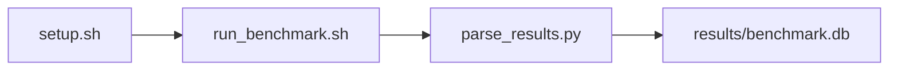

# cuDNN Convolution Microbenchmark Benchmark

[](LICENSE)
[](.github/workflows/ci.yml)

Target: Ubuntu 26.04 · NVIDIA · see Hardware Requirements. This is a host benchmark, not a laptop `pip install` project.

## Quick Start

```bash
git clone https://github.com/garys-gpu-benchmarks/418-gpu-bench-nvidia-cudnn-convolution-micro-ubu2604.git
cd 418-gpu-bench-nvidia-cudnn-convolution-micro-ubu2604
sudo bash setup.sh --assume-yes
bash run_benchmark.sh --profile smoke --validate
```
Results are written to `results/benchmark.db` and `results/summary.json`.

This workload is executed on the validation host after the repository is copied there. `setup.sh` and `run_benchmark.sh` do not open an outbound SSH session.

Prerequisites: Ubuntu 26.04; NVIDIA; Python 3.14.4; root or sudo for `setup.sh`. Framework: Bash, SQLite, Python, PyYAML, CUDA Runtime, NVCC, cuDNN. This is a host benchmark, not a laptop `pip install` project.



## 1. Overview

Builds src/cudnn_conv.cu (includes <cudnn.h>) into bin/cudnn_conv and times forward/backward convolution on synthetic tensors. dtype default FP16. conv_direction, batch_size, input_channels, input_height/width, output_channels, kernel_height/width, stride_h/w, group_count, search_strategy, warmup_iters, and num_iterations come from yaml. Collector runs the harness twice (pass1/pass2/summary) Sweep dimensions: dtype, input_source, conv_direction, batch_size, input_channels, input_height, input_width, output_channels.

## 2. What It Validates

- Validates cuDNN convolution timing and TFLOPS from bin/cudnn_conv. Requires a discoverable cudnn.h and libcudnn
- #1: Convolution kernel execution time, forward (kernel_time_msec); is present and physically sensible.
- #2: Achieved compute throughput, forward (tflops_fwd); is present and physically sensible.
- #3: Memory bandwidth, GB/s, forward (memory_bandwidth_gb_s); is present and physically sensible.
- #4: Solver search time (solver_search_msec), sum of cudnnFind wall time across the directions run is present and physically sensible.

## 3. Metrics Captured

- **#1: Convolution kernel execution time, forward** — stored as `kernel_time_msec`.
- **#2: Achieved compute throughput, forward** — stored as `tflops_fwd`.
- **#3: Memory bandwidth, GB/s, forward** — stored as `memory_bandwidth_gb_s`.
- **#4: Solver search time** — stored as `solver_search_msec`.

## 4. Hardware Requirements

### Supported environment

- OS: Ubuntu 26.04
- GPU vendor: NVIDIA
- Framework family: Bash, SQLite, Python, PyYAML, CUDA Runtime, NVCC, cuDNN
- Python: Python 3.14.4

### Reference validation environment

The tables below describe the machine used to generate the reference results. They are not a requirement that every user buy that exact cloud instance.

### System

Builds src/cudnn_conv.cu (includes <cudnn.h>) into bin/cudnn_conv and times forward/backward convolution on synthetic tensors. dtype default FP16. conv_direction, batch_size, input_channels, input_height/width, output_channels, kernel_height/width, stride_h/w, group_count, search_strategy, warmup_iters, and num_iterations come from yaml.

### GPU

Ubuntu 26.04 / NVIDIA / Bash, SQLite, Python, PyYAML, CUDA Runtime, NVCC, cuDNN

## 5. Software Requirements

| Component | Version |
|---|---|
| OS | Ubuntu 26.04 |
| Kernel | kernel 7.0.0 |
| Python | Python 3.14.4 |
| ROCm | CUDA 13.3 |
| rocBLAS | N/A - rocBLAS not used |

Builds src/cudnn_conv.cu (includes <cudnn.h>) into bin/cudnn_conv and times forward/backward convolution on synthetic tensors. dtype default FP16. conv_direction, batch_size, input_channels, input_height/width, output_channels, kernel_height/width, stride_h/w, group_count, search_strategy, warmup_iters, and num_iterations come from yaml.

## 6. Installation

```bash
Compile cudnn_conv.cu with nvcc -lcudnn; run bin/cudnn_conv twice via collect_cudnn_conv.py
```

## 7. Running the Benchmark

```bash
Compile cudnn_conv.cu with nvcc -lcudnn; run bin/cudnn_conv twice via collect_cudnn_conv.py
```

**Validating results separately:**

```bash
export BENCHMARK_PYTHON=/usr/bin/python3.13  # optional
python3 -m venv .venv
source ".venv/bin/activate"
".venv/bin/python" scripts/validate_results.py
```

## 8. Output

### `results/benchmark.db` (SQLite)

cuDNN convolution CSV from collect_cudnn_conv.py. Forward and both backward directions share one row

check,status,dtype,input_source,conv_direction,batch_size,input_channels,input_height,input_width,output_channels,kernel_height,kernel_width,stride_h,stride_w,group_count,search_strategy,warmup_iters,num_iterations,pad_h,pad_w,dtype_effective,kernel_time_msec,tflops_fwd,tflops_bwd_data,tflops_bwd_weights,solver_search_msec,memory_bandwidth_gb_s,kernel_time_msec_bwd_data,kernel_time_msec_bwd_weights,memory_bandwidth_gb_s_bwd_data,memory_bandwidth_gb_s_bwd_weights,algo_fwd,algo_bwd_data,algo_bwd_weights

```bash
Compile cudnn_conv.cu with nvcc -lcudnn; run bin/cudnn_conv twice via collect_cudnn_conv.py
```

### `results/summary.json`

Consolidated metrics from the most recent run — suitable for CI artifact upload or dashboard ingestion.

### `results/raw/<timestamp>.txt`

cuDNN convolution CSV from collect_cudnn_conv.py. Forward and both backward directions share one row

check,status,dtype,input_source,conv_direction,batch_size,input_channels,input_height,input_width,output_channels,kernel_height,kernel_width,stride_h,stride_w,group_count,search_strategy,warmup_iters,num_iterations,pad_h,pad_w,dtype_effective,kernel_time_msec,tflops_fwd,tflops_bwd_data,tflops_bwd_weights,solver_search_msec,memory_bandwidth_gb_s,kernel_time_msec_bwd_data,kernel_time_msec_bwd_weights,memory_bandwidth_gb_s_bwd_data,memory_bandwidth_gb_s_bwd_weights,algo_fwd,algo_bwd_data,algo_bwd_weights

## 9. Baselines / Thresholds

Expected ranges and gates live in `config/benchmark_config.yaml` under `baselines:` or `thresholds:`. To update them, edit that file — never edit validation code directly.

## 10. Troubleshooting

**`setup.sh` missing collector**
Create cannot finish without `scripts/collect_workload.py`.

**`self_check` overlay rewritten**
Do not overwrite files listed in `results/overlay_lock.json`.

**Remote SSH drop during setup**
Reconnect and resume `bash setup.sh --assume-yes`. Do not wipe `.venv` or `.cache`.

## 11. NVIDIA H100 Coding Differences

Native NVIDIA CUDA workload. Execute on the stated Ubuntu release with the host NVIDIA driver and CUDA userspace. ROCm porting notes do not apply.

## Repository layout

```text
.
├── setup.sh
├── run_benchmark.sh
├── benchmark_specification.json
├── config/
├── scripts/
├── src/
├── tests/
├── docs/
├── results/
└── LICENSE
```
